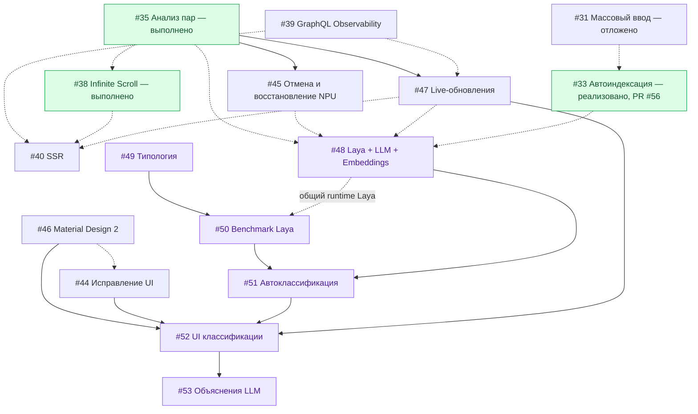

# Project Creator — цель проекта

## Зачем создаём

Fullstack-приложение для управления знаниями о продукте, требованиями и изменениями.
Оно должно помогать понять, зачем существует продукт, как он устроен, что затронет
новая функциональность и кто отвечает за её реализацию и эксплуатацию.

Поддерживаем несколько продуктов и клиентов, включая разные версии, настройки
и доработки продукта у каждого клиента. Разделы развиваются независимо, но
используют общие сущности, связи, версии и источники знаний.

## Участники

- **PM (Product/Project Manager)** — ведёт продукт и процесс, уточняет и согласует требования.
- **Разработчик / технический специалист** — реализует, проверяет и сопровождает продукт.
  Внутри этой группы различаем подроли: фронтенд-разработчик,
  бэкенд-разработчик, тестировщик (QA) и аналитик данных.
- **Заказчик** — покупает продукт для использования и инициирует его расширение.
- **Пользователь** — использует продукт; необходимость отдельного доступа в систему пока открыта.

Роли участников Project Creator и роли внутри описываемого продукта — разные сущности.
Права участников должны учитывать организацию, продукт и клиента.

### Подроли технических специалистов и сценарии работы

Один участник может совмещать несколько подролей в рамках продукта.
Подроль описывает специализацию и помогает выбирать рабочий сценарий;
конкретная ответственность за блок, требование или изменение задаётся отдельно.
Она не определяет виновника ошибки и сама по себе не предоставляет права доступа.
Роли пользователей внутри описываемого продукта по-прежнему моделируются отдельно.

Ниже — направления сценариев для будущего интерфейса. Они уточняют цель проекта;
выбор подролей, персональные экраны и перечисленные процессы ещё не реализованы
в текущем локальном однопользовательском MVP.

| Подроль | Основной фокус | Предлагаемый сценарий работы |
| --- | --- | --- |
| Фронтенд-разработчик | Интерфейсы, пользовательские сценарии и клиентская интеграция | Открыть изменение → изучить требования, сценарии, макеты и API-контракт → определить затронутые экраны и состояния → реализовать интерфейс и проверить критерии приёмки. |
| Бэкенд-разработчик | Бизнес-правила, API, данные и интеграции | Открыть изменение → изучить правила, контракты и зависимости → оценить изменения API, хранения и миграций → реализовать и проверить серверное поведение. |
| Тестировщик (QA) | Проверяемость требований, качество и регрессии | Открыть требование или изменение → уточнить критерии приёмки и риски → подготовить сценарии проверки → зафиксировать результат и связать найденные дефекты с требованиями и версией продукта. |
| Аналитик данных | Метрики, источники данных и аналитические проверки | Открыть цель или изменение → уточнить определения метрик и источники → проверить наличие и качество данных → подготовить расчёт или анализ с основаниями и ограничениями. |

Общие требования, связи, версии и источники сохраняются для всех подролей.
Различаться могут начальная точка, представление информации и порядок действий.
Смена рабочего сценария должна сохранять область доступа организации, продукта
и клиента; подробная матрица разрешений остаётся открытым решением.
Аналитик данных не заменяет PM при согласовании бизнес-требований.

## Предполагаемые разделы

1. **Продукты и цели.** Назначение, решаемые проблемы, аудитория, границы и критерии успеха.
2. **Устройство продукта.** Процессы, сценарии, функциональные блоки, бизнес-правила,
   зависимости, интеграции, роли пользователей и доступ к функциональности.
   Бизнес-процесс, функциональный блок и технический компонент различаются.
3. **Требования и изменения.** Сбор и согласование требований, критерии приёмки,
   поиск дубликатов, противоречий, неоднозначностей и недостающих условий.
4. **Влияние изменений и риски.** Критичные блоки, затронутые зависимости и клиенты,
   совместимость, миграции, тестирование, выпуск и откат; оценка сложности перехода.
5. **Планирование и разработка.** Декомпозиция, зависимости задач, загрузка команд,
   оценка трудозатрат и календарных сроков задач и блоков, сравнение плана и факта.
   Собственный трекер или адаптеры существующих трекеров — решение пока открыто.
6. **Ответственность и качество.** Владельцы блоков, ответственность фронтенда,
   бэкенда и инфраструктуры, маршрутизация багов, тесты и инциденты.
   Ответственный за первичный разбор не обязательно является источником ошибки.
7. **Клиенты и внедрения.** Связь клиента с продуктом, версии, подключённые модули,
   настройки, доработки, интеграции и текущее состояние каждого внедрения.
   Оперативное состояние требует данных мониторинга и развёртываний.
8. **Аудитория и рынки.** География, города и поселения, качество интернета,
   устройства, проблемы групп пользователей, регионы продаж и рекламные сегменты.
   Факты о пользователях отделяются от рыночных гипотез.
9. **Экономика и ценообразование.** Стоимость разработки блоков, эксплуатации,
   поддержки и внедрения; тарифы, региональные и специальные условия,
   расчёт цены для клиента и рентабельности. Себестоимость и цена различаются.
10. **Документация и обучение.** Инструкции для пользователей, заказчиков,
    разработчиков и PM с учётом версии и конфигурации; выявление устаревших материалов.
11. **Бренд и продвижение.** Названия продукта и блоков, лозунги, иконки,
    позиционирование, ценностное предложение и обоснование покупки.
12. **Поиск, граф связей и AI-ассистент.** Поиск по словам, фразам и смыслу,
    просмотр связанных сущностей и графа, в том числе представление в Mermaid;
    ответы с источниками и проверка информации без обязательного диалога.

Это карта развития, а не обязательство реализовать все разделы в первой версии.

## Знания и AI

- Структурированные сущности и явные связи — основа системы.
  RAG дополняет их поиском по документам, а не заменяет модель данных.
- Утверждения имеют источник, версию, статус согласования и историю изменений.
  Подтверждённые факты, предложения модели и предположения различаются.
- Предусмотрены три интерфейса: обычные формы и поиск, автоматическая проверка
  вводимой информации, небольшой чат-ассистент с доступом к RAG.
- Приоритет — локальные модели, включая генерацию и embeddings:
  основной AI-сценарий должен работать без обязательного облачного API.
- Внешние провайдеры подключаются опционально через адаптеры:
  OpenAI (модели ChatGPT через API), Anthropic и аналогичные сервисы.
  Облачная обработка включается явно; незаметного перехода с локальной модели
  на внешний API быть не должно.
- Доступ к источникам проверяется до передачи контекста модели.
  Ответы, поиск и граф не должны раскрывать данные другого клиента.
- Для ответа показываются источники и ограничения. При недостатке данных
  система сообщает об этом, а не выдаёт догадку за факт.
- Вероятностные оценки сроков и рисков — отдельная возможность, требующая
  данных и проверки качества прогнозов. Самооценка LLM не является
  откалиброванной вероятностью достоверности. До появления данных используем
  объяснимые оценки, диапазоны и явные предположения.

## Предлагаемая первая версия

Основной сценарий: PM описывает продукт, его блоки и действующие требования,
затем вводит новое требование. Система помогает найти возможные противоречия,
связанные блоки, ответственных и вопросы, которые необходимо уточнить.

Минимальный объём:

1. Паспорт продукта и участники с базовым разграничением доступа.
2. Функциональные блоки, правила, требования и явные связи между ними.
3. Источники, статусы согласования и история изменений требований.
4. Поиск и просмотр связей.
5. Проверка нового требования с локальной моделью и RAG:
   возможные противоречия, затронутые блоки, уточняющие вопросы и ссылки на основания.
6. Тонкий интерфейс провайдера моделей, допускающий подключение внешних API.

Критерии проверки первой версии:

- На подготовленных примерах проверка находит известное противоречие и показывает его источники.
- Отсутствие найденного противоречия не представляется доказательством корректности.
- Предложения модели не изменяют согласованные требования автоматически.
- Основной сценарий работает с локальной моделью без облачных ключей.
- Пользователь не получает чужие закрытые данные через поиск, граф или AI.
- Основные операции с продуктом и требованиями доступны без чата.

Брендинг, рыночная аналитика, сложное ценообразование, собственный полноценный
таск-трекер и статистические прогнозы находятся за пределами первой версии.
Границы первой версии являются предложением и уточняются по мере разработки.

## Технические ориентиры и процесс

- **Go** — язык реализованного backend MVP; выбор для всей целевой архитектуры
  остаётся предварительным, без обязательства использовать его во всех будущих компонентах.
- **Next.js + TypeScript** — выбранное направление фронтенда.
- **GraphQL** — основной контракт запросов и мутаций. Версионируемая SDL-схема
  хранится в репозитории; из неё генерируются типы и типизированные операции фронтенда.
- **SSE** — доставка с бэкенда ключей (тегов) инвалидации клиентского кеша,
  с восстановлением актуальности после разрыва соединения.
- Общий декларативный контракт валидации используется фронтендом и бэкендом;
  сервер остаётся окончательным источником проверки.
- Ошибки ввода возвращаются с путём поля, стабильным кодом, ключом перевода
  и параметрами. Текущий API поддерживает ошибки полей; вложенные сущности
  и отдельные общие ошибки формы требуют расширения SDL.
- Все пользовательские тексты проходят через i18n. Общие словари для Go и
  TypeScript хранятся в репозитории; технические логи и пользовательский контент
  не являются переводимыми интерфейсными строками.
- Основное хранилище — PostgreSQL + pgvector ([ADR-001](docs/adr/001-postgresql-pgvector.md)).
  В MVP используются Ollama, BGE-M3 embeddings и точный cosine-поиск;
  генератор Qwen2.5 7B настраивается отдельно. Локальный запуск всего MVP
  описан в корневом README; Docker Compose хранит БД и веса Ollama в volumes.
  Экспериментальный генератор OpenVINO на Intel NPU выбирается явно и использует
  веса и runtime на хосте ([ADR-002](docs/adr/002-openvino-npu.md)); фиксированные
  аппаратные примеры, включая недостаток данных, проходят после нормализации
  ссылок. Полная приёмка с сопоставлением CPU/GPU остаётся отдельной задачей.
- Детали контрактов и критерии проверки описаны в [ARCHITECTURE.md](ARCHITECTURE.md).
- Начинаем с простого приложения с явными границами модулей;
  независимость разделов сама по себе не требует микросервисов.
- Разработка по **TDD: Red → Green → Refactor**.
- Бизнес-логика отделяется от транспорта, хранения и провайдеров моделей.
- Обычные тесты воспроизводимы и не требуют внешних API или работающей LLM;
  реальные модели проверяются отдельными интеграционными тестами и оценочными наборами.

## Согласованная последовательность ближайших задач

Диаграмма задаёт порядок и зависимости ближайших задач, а не расширяет объём
первой версии до всей карты развития. Сплошные стрелки обозначают обязательную
последовательность, пунктирные — рекомендуемый порядок или связь между работами.
Зелёным выделены завершённые предпосылки и реализованные задачи,
фиолетовым — ветка AI и классификации.

Сверка с GitHub от **4 ноября 2026 года**: #35 и #38 закрыты как выполненные;
остальные задачи диаграммы открыты. Завершённые узлы оставлены для объяснения
зависимостей. Это исходная сверка статусов issues; обновление реализации указано отдельно.

**Обновление от 5 ноября 2026 года:** #33 реализована в
[PR #56](https://github.com/VolkovDani/project-creator/pull/56): долговечная очередь
индексации, ограниченные повторы, восстановление, проверка версии/профиля и общий
прогресс проекта через GraphQL/SSE. Локальные Go/PostgreSQL, race, frontend и
браузерные проверки прошли. PR ожидает слияния; issue остаётся открытой до merge.

Уточнения порядка по описаниям открытых issues:

- #31 отложена до пересмотра формата массового ввода: записи могут быть
  многострочными, поэтому исходная схема «одна строка — одно требование» требует
  переработки ([уточнение в issue](https://github.com/VolkovDani/project-creator/issues/31#issuecomment-6539154943)).
- #33 не требует завершения #31: очередь индексации можно реализовать независимо,
  предусмотрев будущий массовый ввод. Запрет автоиндексации в #31 относится
  к объёму этой задачи; автоматизацию добавляет отдельная #33.
- #44 может включать срочные исправления до завершения #46; компонентная база
  должна учитывать эти исправления.
- #50 согласуется с общим runtime из #48, но не требует завершения всего конвейера
  анализа пар перед подготовкой эталонного набора.
- В #48 остались исходные упоминания лимита 20 пар и будущей #35; при реализации
  учитывать уже завершённую #35 и её актуальные режимы отбора, дубли и кеш.

Всего открыто **16 issues**. Помимо 14 открытых задач диаграммы остаются отдельные
аппаратные направления без заданного здесь порядка:

- [#22 — Intel NPU](https://github.com/VolkovDani/project-creator/issues/22):
  оставшиеся проверки embeddings на NPU, качества и сравнения CPU/GPU.
- [#42 — AMD ROCm и Vulkan](https://github.com/VolkovDani/project-creator/issues/42):
  разделение профилей и проверка поддержки AMD iGPU/dGPU.

## Открытые решения

- Подробные права ролей и необходимость доступа конечного пользователя.
- Проверка качества выбранных локальных моделей на реальных требованиях и параметры будущего hybrid-поиска.
- Расширение и возможный пересмотр текущих средств GraphQL, кеша, codegen,
  валидации и i18n. В MVP уже используются graph-gophers/graphql-go,
  GraphQL Code Generator для TypeScript, собственный Go codegen, клиентский
  кеш с тегами, общие JSON-контракты валидации и словари RU/EN.
- Качество локальных моделей на целевых языках, данных и оборудовании.
- Первый внешний провайдер и политика передачи данных.
- Первые интеграции с трекером, репозиторием и документацией.
- Конкретные данные и методика для оценки сроков и рисков.

