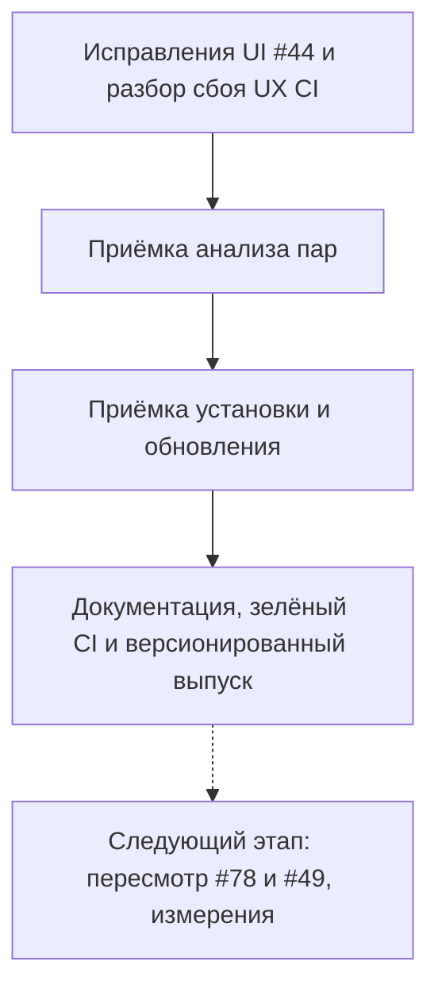

# Project Creator — цель проекта

## Зачем создаём

Fullstack-приложение для управления знаниями о продукте, требованиями и изменениями.
Оно должно помогать понять, зачем существует продукт, как он устроен, что затронет
новая функциональность и кто отвечает за её реализацию и эксплуатацию.

Поддерживаем несколько продуктов и клиентов, включая разные версии, настройки
и доработки продукта у каждого клиента. Разделы развиваются независимо, но
используют общие сущности, связи, версии и источники знаний.

## Участники

- **PM (Product/Project Manager)** — ведёт продукт и процесс, уточняет и согласует требования.
- **Разработчик / технический специалист** — реализует, проверяет и сопровождает продукт.
  Внутри этой группы различаем подроли: фронтенд-разработчик,
  бэкенд-разработчик, тестировщик (QA) и аналитик данных.
- **Заказчик** — покупает продукт для использования и инициирует его расширение.
- **Пользователь** — использует продукт; необходимость отдельного доступа в систему пока открыта.

Роли участников Project Creator и роли внутри описываемого продукта — разные сущности.
Права участников должны учитывать организацию, продукт и клиента.

### Подроли технических специалистов и сценарии работы

Один участник может совмещать несколько подролей в рамках продукта.
Подроль описывает специализацию и помогает выбирать рабочий сценарий;
конкретная ответственность за блок, требование или изменение задаётся отдельно.
Она не определяет виновника ошибки и сама по себе не предоставляет права доступа.
Роли пользователей внутри описываемого продукта по-прежнему моделируются отдельно.

Ниже — направления сценариев для будущего интерфейса. Они уточняют цель проекта;
выбор подролей, персональные экраны и перечисленные процессы ещё не реализованы
в текущем локальном однопользовательском MVP.

| Подроль | Основной фокус | Предлагаемый сценарий работы |
| --- | --- | --- |
| Фронтенд-разработчик | Интерфейсы, пользовательские сценарии и клиентская интеграция | Открыть изменение → изучить требования, сценарии, макеты и API-контракт → определить затронутые экраны и состояния → реализовать интерфейс и проверить критерии приёмки. |
| Бэкенд-разработчик | Бизнес-правила, API, данные и интеграции | Открыть изменение → изучить правила, контракты и зависимости → оценить изменения API, хранения и миграций → реализовать и проверить серверное поведение. |
| Тестировщик (QA) | Проверяемость требований, качество и регрессии | Открыть требование или изменение → уточнить критерии приёмки и риски → подготовить сценарии проверки → зафиксировать результат и связать найденные дефекты с требованиями и версией продукта. |
| Аналитик данных | Метрики, источники данных и аналитические проверки | Открыть цель или изменение → уточнить определения метрик и источники → проверить наличие и качество данных → подготовить расчёт или анализ с основаниями и ограничениями. |

Общие требования, связи, версии и источники сохраняются для всех подролей.
Различаться могут начальная точка, представление информации и порядок действий.
Смена рабочего сценария должна сохранять область доступа организации, продукта
и клиента; подробная матрица разрешений остаётся открытым решением.
Аналитик данных не заменяет PM при согласовании бизнес-требований.

## Предполагаемые разделы

1. **Продукты и цели.** Назначение, решаемые проблемы, аудитория, границы и критерии успеха.
2. **Устройство продукта.** Процессы, сценарии, функциональные блоки, бизнес-правила,
   зависимости, интеграции, роли пользователей и доступ к функциональности.
   Бизнес-процесс, функциональный блок и технический компонент различаются.
3. **Требования и изменения.** Сбор и согласование требований, критерии приёмки,
   поиск дубликатов, противоречий, неоднозначностей и недостающих условий.
4. **Влияние изменений и риски.** Критичные блоки, затронутые зависимости и клиенты,
   совместимость, миграции, тестирование, выпуск и откат; оценка сложности перехода.
5. **Планирование и разработка.** Декомпозиция, зависимости задач, загрузка команд,
   оценка трудозатрат и календарных сроков задач и блоков, сравнение плана и факта.
   Собственный трекер или адаптеры существующих трекеров — решение пока открыто.
6. **Ответственность и качество.** Владельцы блоков, ответственность фронтенда,
   бэкенда и инфраструктуры, маршрутизация багов, тесты и инциденты.
   Ответственный за первичный разбор не обязательно является источником ошибки.
7. **Клиенты и внедрения.** Связь клиента с продуктом, версии, подключённые модули,
   настройки, доработки, интеграции и текущее состояние каждого внедрения.
   Оперативное состояние требует данных мониторинга и развёртываний.
8. **Аудитория и рынки.** География, города и поселения, качество интернета,
   устройства, проблемы групп пользователей, регионы продаж и рекламные сегменты.
   Факты о пользователях отделяются от рыночных гипотез.
9. **Экономика и ценообразование.** Стоимость разработки блоков, эксплуатации,
   поддержки и внедрения; тарифы, региональные и специальные условия,
   расчёт цены для клиента и рентабельности. Себестоимость и цена различаются.
10. **Документация и обучение.** Инструкции для пользователей, заказчиков,
    разработчиков и PM с учётом версии и конфигурации; выявление устаревших материалов.
11. **Бренд и продвижение.** Названия продукта и блоков, лозунги, иконки,
    позиционирование, ценностное предложение и обоснование покупки.
12. **Поиск, граф связей и AI-ассистент.** Поиск по словам, фразам и смыслу,
    просмотр связанных сущностей и графа, в том числе представление в Mermaid;
    ответы с источниками и проверка информации без обязательного диалога.

Это карта развития, а не обязательство реализовать все разделы в первой версии.

## Знания и AI

- Структурированные сущности и явные связи — основа системы.
  RAG дополняет их поиском по документам, а не заменяет модель данных.
- Утверждения имеют источник, версию, статус согласования и историю изменений.
  Подтверждённые факты, предложения модели и предположения различаются.
- Предусмотрены три интерфейса: обычные формы и поиск, автоматическая проверка
  вводимой информации, небольшой чат-ассистент с доступом к RAG.
- Приоритет — локальные модели, включая генерацию и embeddings:
  основной AI-сценарий должен работать без обязательного облачного API.
- Внешние провайдеры подключаются опционально через адаптеры:
  OpenAI (модели ChatGPT через API), Anthropic и аналогичные сервисы.
  Облачная обработка включается явно; незаметного перехода с локальной модели
  на внешний API быть не должно.
- Доступ к источникам проверяется до передачи контекста модели.
  Ответы, поиск и граф не должны раскрывать данные другого клиента.
- Для ответа показываются источники и ограничения. При недостатке данных
  система сообщает об этом, а не выдаёт догадку за факт.
- Вероятностные оценки сроков и рисков — отдельная возможность, требующая
  данных и проверки качества прогнозов. Самооценка LLM не является
  откалиброванной вероятностью достоверности. До появления данных используем
  объяснимые оценки, диапазоны и явные предположения.

## Предлагаемая первая версия продукта (долгосрочный ориентир)

Основной сценарий: PM описывает продукт, его блоки и действующие требования,
затем вводит новое требование. Система помогает найти возможные противоречия,
связанные блоки, ответственных и вопросы, которые необходимо уточнить.

Этот раздел описывает более широкий продуктовый ориентир, а не обязательный
объём ближайшего релиза анализа пар, определённый ниже.

Минимальный объём предлагаемой версии:

1. Паспорт продукта и участники с базовым разграничением доступа.
2. Функциональные блоки, правила, требования и явные связи между ними.
3. Источники, статусы согласования и история изменений требований.
4. Поиск и просмотр связей.
5. Проверка нового требования с локальной моделью и RAG:
   возможные противоречия, затронутые блоки, уточняющие вопросы и ссылки на основания.
6. Тонкий интерфейс провайдера моделей, допускающий подключение внешних API.

Критерии проверки первой версии:

- На подготовленных примерах проверка находит известное противоречие и показывает его источники.
- Отсутствие найденного противоречия не представляется доказательством корректности.
- Предложения модели не изменяют согласованные требования автоматически.
- Основной сценарий работает с локальной моделью без облачных ключей.
- Пользователь не получает чужие закрытые данные через поиск, граф или AI.
- Основные операции с продуктом и требованиями доступны без чата.

Брендинг, рыночная аналитика, сложное ценообразование, собственный полноценный
таск-трекер и статистические прогнозы находятся за пределами первой версии.
Границы первой версии являются предложением и уточняются по мере разработки.

## Технические ориентиры и процесс

- **Go** — язык реализованного backend MVP; выбор для всей целевой архитектуры
  остаётся предварительным, без обязательства использовать его во всех будущих компонентах.
- **Next.js + TypeScript** — выбранное направление фронтенда.
- **GraphQL** — основной контракт запросов и мутаций. Версионируемая SDL-схема
  хранится в репозитории; из неё генерируются типы и типизированные операции фронтенда.
- **SSE** — доставка с бэкенда ключей (тегов) инвалидации клиентского кеша,
  с восстановлением актуальности после разрыва соединения.
- Общий декларативный контракт валидации используется фронтендом и бэкендом;
  сервер остаётся окончательным источником проверки.
- Ошибки ввода возвращаются с путём поля, стабильным кодом, ключом перевода
  и параметрами. Текущий API поддерживает ошибки полей; вложенные сущности
  и отдельные общие ошибки формы требуют расширения SDL.
- Все пользовательские тексты проходят через i18n. Общие словари для Go и
  TypeScript хранятся в репозитории; технические логи и пользовательский контент
  не являются переводимыми интерфейсными строками.
- Основное хранилище — PostgreSQL + pgvector ([ADR-001](docs/adr/001-postgresql-pgvector.md)).
  В MVP используются Ollama, BGE-M3 embeddings и точный cosine-поиск;
  генератор Qwen2.5 7B настраивается отдельно. Локальный запуск всего MVP
  описан в корневом README; Docker Compose хранит БД и веса Ollama в volumes.
  Экспериментальный генератор OpenVINO на Intel NPU выбирается явно и использует
  веса и runtime на хосте ([ADR-002](docs/adr/002-openvino-npu.md)); фиксированные
  аппаратные примеры, включая недостаток данных, проходят после нормализации
  ссылок. Полная приёмка с сопоставлением CPU/GPU остаётся отдельной задачей.
- Детали контрактов и критерии проверки описаны в [ARCHITECTURE.md](ARCHITECTURE.md).
- Начинаем с простого приложения с явными границами модулей;
  независимость разделов сама по себе не требует микросервисов.
- Разработка по **TDD: Red → Green → Refactor**.
- Бизнес-логика отделяется от транспорта, хранения и провайдеров моделей.
- Обычные тесты воспроизводимы и не требуют внешних API или работающей LLM;
  реальные модели проверяются отдельными интеграционными тестами и оценочными наборами.

## Ближайший релиз: завершение и приёмка анализа пар

Ближайший выпуск ограничен существующим локальным однопользовательским MVP:
требования, их версии и индексация, поиск, анализ пар и управление выполнением.
Типология, автоклассификация записей, глоссарий, база знаний и карта связей
относятся к следующему этапу и не являются условиями этого выпуска.
Это граница работ, а не утверждение о готовности текущего HEAD.

### Снимок состояния на 16 ноября 2026 года

Проверенный `main`: [`d1ccde5`](https://github.com/VolkovDani/project-creator/commit/d1ccde5ff97ac23d1c46ca99c44af580502247e9).
[PR #80](https://github.com/VolkovDani/project-creator/pull/80) исправил
нестабильную проверку завершения infinite scroll; [PR #43](https://github.com/VolkovDani/project-creator/pull/43)
добавил AMD Vulkan, [PR #82](https://github.com/VolkovDani/project-creator/pull/82)
— завершающий CI job для явно разрешённого автомержа. Все три PR слиты.

Релизные UI-исправления #44 представлены в [PR #83](https://github.com/VolkovDani/project-creator/pull/83),
инструкции автомержа — в [PR #84](https://github.com/VolkovDani/project-creator/pull/84).
На момент сверки оба открыты, без конфликтов, с успешным CI на своих SHA;
их изменения не входят в проверенный `main`.

По [#85](https://github.com/VolkovDani/project-creator/issues/85) выполнена
[детерминированная приёмка анализа пар](docs/pair-analysis-acceptance.md):
225 Go-тестов, 67 frontend unit и 44 E2E прошли; 10 opt-in аппаратных тестов
не запускались. Исторический сбой UX CI больше не является актуальным
блокером на этом срезе. Результаты заглушек не подтверждают качество моделей.
Сохраняются приёмка реального модельного профиля, производительность,
установка/обновление и проверка окончательного SHA после интеграции UI.
`npm audit` выявил предупреждения в dev-цепочке codegen; до выпуска нужна
отдельная оценка и обновление, подробности — в отчёте #85.

### Уже реализованная основа

**Завершена #33:** [PR #56](https://github.com/VolkovDani/project-creator/pull/56)
слит 5 ноября 2026 года: долговечная очередь
индексации, ограниченные повторы, восстановление, проверка версии/профиля и общий
прогресс проекта через GraphQL/SSE. Реализация входит в текущую ветку репозитория;
анализ требований по-прежнему запускается явно. Результаты проверок реализации
перечислены в PR; реальные модели и оборудование в этих проверках не использовались.

**Завершена #59:** [PR #60](https://github.com/VolkovDani/project-creator/pull/60)
слит 5 ноября 2026 года. Кнопка отменяет весь выполняющийся анализ: текущую пару,
все ожидающие пары и незавершённую подготовку. Готовые результаты сохраняются,
поздний ответ отменённого вызова не публикуется. Следующий явный запуск или повтор
после пользовательской отмены восстанавливает NPU worker с теми же закреплёнными
моделью и профилем. Отменённая проверка автоматически не повторяется.
Timeout, неожиданное завершение worker и изменение файлов модели по-прежнему
требуют операторского восстановления. Регрессии проверены детерминированными
тестами; готовность локального NPU подтверждена через health, аппаратный сценарий
«отмена → новая генерация» в этих проверках не выполнялся.

**Реализована #45:** [PR #65](https://github.com/VolkovDani/project-creator/pull/65)
добавляет явную замену параметров с выбором ожидания текущей пары или отмены
inference. Запрос замены сохраняется в БД; пригодный результат текущей пары
переиспользуется, оставшаяся старая очередь останавливается. Новый inference
начинается после завершения старого; NPU восстанавливается с закреплённым профилем
и ограниченной попыткой восстановления. Добавлены диагностика причин и ADR-007.
Детерминированные проверки и отдельный аппаратный сценарий
«отмена → остановка worker → восстановление → новая генерация» прошли;
методика и ограничения описаны в [инструкции NPU](docs/intel-npu.md).
Это проверка lifecycle, а не общей точности модели или сравнения CPU/GPU из #22.

**Завершена #47:** [PR #63](https://github.com/VolkovDani/project-creator/pull/63)
слит 5 ноября 2026 года. Компактные SSE-снимки с ревизией запуска и адресные
обновления заменили общую инвалидацию при прогрессе анализа. Тексты пар и
происхождение модели загружаются при раскрытии и кешируются отдельно.
Сохранены отмена, retry, изоляция и защита от устаревших ответов.
Методика и ограничения замеров описаны в
[отчёте](docs/analysis-live-performance.md); реальные модели и оборудование
в этих проверках не использовались. #39 остаётся в BACKLOG.

**Завершены #48 + #72:** [PR #71](https://github.com/VolkovDani/project-creator/pull/71)
слит 9 ноября 2026 года после успешного CI. По указанию владельца
#72 выполнена в том же PR вместе с #48. Выжимки создаются автоматически
после сохранения требования и используются как превью карточки; полный оригинал
доступен по раскрытию. 350 UTF-8 байт — мягкая цель размера и условие допуска
выжимки в Laya, но не ограничение хранения: длинная корректная выжимка сохраняется.
Если выжимка отсутствует, завершилась ошибкой, превышает 350 байт или Laya
завершилась ошибкой, пара пропускает Laya, а финальная LLM всё равно сравнивает
полные оригиналы. Предварительная ошибка сохраняется как причина пропуска.
Аппаратно проверены 21 пара на CPU + NPU и Arc + NPU, поиск при анализе и
сквозной путь реальных выжимок до полного сравнения на NPU
([отчёт](docs/requirement-summary-verification.md)). Исторический строгий
оценочный набор Qwen v2 имел непрошедшие плотные примеры. Quality smoke нового
профиля v3 прошёл 4/5: валидные плотные выжимки 447 и 767 байт сохранены, но не
допущены в Laya; генерация примера с 90 идентификаторами завершилась таймаутом
без публикации результата.

**Завершена #73:** [PR #74](https://github.com/VolkovDani/project-creator/pull/74)
слит 9 ноября 2026 года и входит в `main`. Выжимки используют только разрешённые языки
(по умолчанию русский и английский), цифры и символы. Список меняется через
`PROJECT_CREATOR_SUMMARY_LANGUAGES` в `.env`; он входит в профиль генерации.
Сервер проверяет допустимый алфавит, модель получает языковую инструкцию.
Исходные требования это ограничение не затрагивает. Проверка алфавита
не является полной лингвистической детекцией языка.

### Порядок подготовки выпуска

| Шаг | Работа | Условие завершения |
| --- | --- | --- |
| 1. Интерфейс | Разобрать падение infinite scroll, выполнить релизные исправления #44, не ожидая #46. | Тексты и объяснения читаемы, действия не перекрыты; проверены узкий экран и 1920×1080. Причина сбоя установлена и устранена, а не скрыта увеличением таймаута. |
| 2. Анализ пар | Пройти полный цикл на фиксированном наборе требований. | Проверены результаты, версии, счётчики, кеш, отмена, повтор и восстановление; качество реальных моделей проверено отдельно от CI с заглушками. |
| 3. Установка | Чистая установка, обновление существующей БД, приёмка явно выбранного модельного профиля. | Запуск воспроизводим, данные сохранены, ошибки диагностируются; закреплены модели, runtime и настройки. |
| 4. Выпуск | Актуализировать README, ограничения и release notes. | Зелёный CI на финальном SHA и версионированный релиз с зафиксированной конфигурацией. |

До реализации оформить отдельные задачи на сбой CI, общую релизную приёмку
и выпуск: #44 покрывает лишь часть подготовки. Каждая задача с изменением кода
выполняется отдельным PR. Этот план сам по себе не создаёт и не изменяет Issues.

Обязательные сценарии приёмки:

- В `all` учтены все ожидаемые пары; в `related` неотобранные пары не называются
  проверенными. Точные дубли и результаты из кеша отличимы от нового вызова модели.
- Фиксированные противоречия, дубли, совместимые случаи и недостаток данных;
  источники, версии и ограничения вывода доступны пользователю.
- Изменение требования во время анализа, устаревание результата и повторное
  использование пригодного кеша без лишних модельных вызовов.
- Отмена, замена запуска, рестарт, потеря SSE, таймаут и недоступность модели.
- Отсутствующая или слишком длинная выжимка не блокирует сравнение оригиналов
  в пределах контекста выбранной финальной модели; скрытое обрезание недопустимо.
- Поиск во время анализа; время и память на выбранном размере проекта.
  Допустимый размер и пороги приёмки ещё нужно определить и зафиксировать.

Ограничения текущего конвейера подтверждены кодом:
[prepare.go](internal/analysis/prepare.go) перебирает потенциальные пары порциями
и в режиме `related`; снижение числа вызовов моделей не устраняет квадратичный
перебор. В [pipeline.go](internal/analysis/pipeline.go) результат Laya не отсекает
пару от финального сравнения; ошибка или пропуск Laya допускают сравнение полных
оригиналов. Точные дубли обрабатываются детерминированно, готовые результаты
могут переиспользоваться из кеша. Экономия за счёт Laya пока не доказана.
Результат quality smoke выжимок v3 — **4/5, один таймаут**; это ограничение
сохраняется в [отчёте](docs/requirement-summary-verification.md).

### Следующий этап и открытые согласования

Это направления и предложения к пересмотру задач, а не утверждённая новая
архитектура или обязательство внедрить все перечисленные возможности.

| Задачи | Место в плане |
| --- | --- |
| #22 — Intel NPU | Приёмка выбранного релизного профиля входит в выпуск; исследования embeddings и сравнение CPU/GPU/NPU остаются отдельной работой. |
| #46 — Material Design 2; #40 — SSR | После релиза; SSR — по измеренной необходимости. #44 не ждёт полной компонентной базы. |
| #49–53 — типология и классификация | После пересмотра модели данных и измерений качества; benchmark #50 должен предшествовать решению о способе автоклассификации. |
| [#77 — глоссарий](https://github.com/VolkovDani/project-creator/issues/77) | Следующий этап: согласование общего доменного контекста. |
| #57–58 — Mermaid и карта | После согласования модели отношений; #57 предоставляет viewer, #58 отображает реальные сохранённые связи. Не блокируют выпуск анализа пар. |
| #64 — поиск BGE-M3 | Отложенное исследование; сначала пересмотреть гипотезы по результатам Laya и согласовать с #78. Внедрение требует отдельного решения и PR. |
| [#78 — база знаний](https://github.com/VolkovDani/project-creator/issues/78) | Исследовательское направление после релиза, с сохранением текущего анализа пар как baseline. BACKLOG: старт только по отдельному явному указанию владельца. |
| #39 — observability | BACKLOG: не начинать и не создавать ветку или PR без отдельного явного указания владельца. |

Перед реализацией следующего этапа необходимо согласовать:

- Единый контракт статусов #49/#52 или явное отображение серверных статусов в UI:
  в #49 указаны `queued/classifying/suggested`, а #52 перечисляет `running`.
- Выбор модели и автоматизации #51 по результатам #50; при недостаточном
  качестве рассмотреть ручную классификацию и `needs_review`.
- Доступность объяснений #53 для ручной классификации и работы без Laya.
  Сейчас #53 описывает отдельное объяснение генеративной LLM по запросу после
  сохранения результата Laya, а #51 допускает отсутствие настроенной Laya.
- Общую модель связей, происхождения и актуальности для #58/#78;
  это пересечение направлений, а не доказанное противоречие текущей реализации;
  автоматическая классификация не должна становиться неявным условием просмотра
  уже сохранённых связей. Одинаковый тип сам по себе не создаёт связь.
- Общий эталонный набор и baseline для поиска кандидатов в #64/#78.
- Актуализацию описаний #44/#46 относительно `main` и границы классификации в #78.

Предлагаемый порядок: пересмотр #78/#49 → измерения качества и стоимости текущего
анализа → согласование глоссария, отношений и поиска кандидатов → решение об
автоклассификации, её UI и объяснениях. Экспериментальную работу предлагается вести
в `experiment/knowledge-base`; перенос результатов в `main` — после измерений
и отдельного решения. Создание ветки этим документом не подтверждается.

Сохраняются прежние решения: #31 закрыта без реализации сценария «одна строка —
одно требование», новый формат массового ввода не согласован. #33 завершена
независимо от #31; ссылки на #31 не возвращают её в план. Исторические ограничения
20 пар из #48 не заменяют текущие режимы, дубли и кеш #35.

## Открытые решения

- Подробные права ролей и необходимость доступа конечного пользователя.
- Проверка качества выбранных локальных моделей на реальных требованиях и параметры будущего hybrid-поиска.
- Расширение и возможный пересмотр текущих средств GraphQL, кеша, codegen,
  валидации и i18n. В MVP уже используются graph-gophers/graphql-go,
  GraphQL Code Generator для TypeScript, собственный Go codegen, клиентский
  кеш с тегами, общие JSON-контракты валидации и словари RU/EN.
- Качество локальных моделей на целевых языках, данных и оборудовании.
- Первый внешний провайдер и политика передачи данных.
- Первые интеграции с трекером, репозиторием и документацией.
- Конкретные данные и методика для оценки сроков и рисков.

